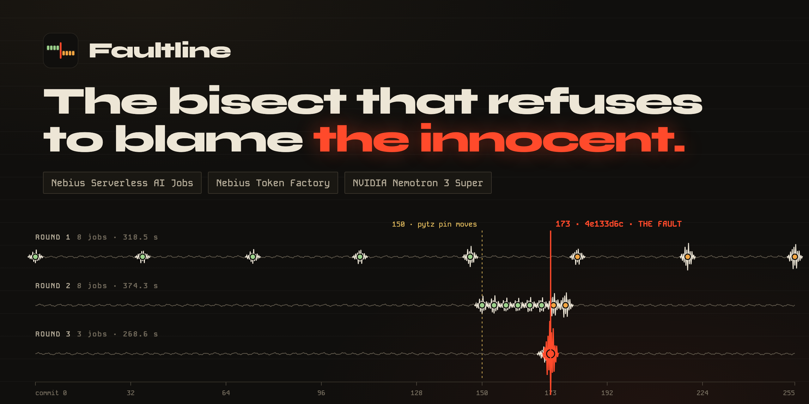

<div align="center">


# Faultline 〰️

**The bisect that refuses to blame the innocent.**
Faultline bisects a broken commit range by testing each suspect in a fresh Nebius container built from that commit's own dependencies. It proves both ends first, refuses to guess when the evidence disagrees, and has NVIDIA Nemotron on Nebius Token Factory explain the culprit.



[](https://faultline.edycu.dev)
[](https://faultline.edycu.dev/about)
[](https://faultline.edycu.dev/pitch)
[](https://youtu.be/Run-JvgkCy4)
[](FEEDBACK.md)
[](https://nebiusglobalaihackathon.devpost.com/)

[](https://docs.tokenfactory.nebius.com/sandboxes/overview)
[](https://docs.nebius.com/serverless)
[](https://docs.tokenfactory.nebius.com)
[](https://huggingface.co/nvidia)
[](https://nextjs.org)
[](#-testing--ci) [](#-testing--ci)
[](https://github.com/edycutjong/faultline/actions/workflows/ci.yml)
[](https://github.com/edycutjong/faultline/releases)
[](LICENSE)

</div>

---

## 💡 The Problem & Solution

### The Problem

`git bisect` is the right algorithm. What is unsafe is running it unattended in the environment
you already have. A Python repository pins its dependencies, and the pins move across a commit
range — so commit N's test is only right under commit N's pins. Bisect every commit in one
reused environment and some verdicts are wrong, the search goes down the wrong half, and an
innocent commit gets blamed with total confidence.

We measured it. On a 255-commit history whose `pytz` pin moves partway through (a generated
fixture, [`faultbench-tzdata-pipeline`](https://github.com/edycutjong/faultbench-tzdata-pipeline);
its planted commit is listed in [`scripts/README.md`](scripts/README.md) and the whole history
regenerates byte-for-byte), `git bisect run` in one reused environment named the wrong commit in
**10 of 10 runs** (two setups, five runs each) — the dependency bump when the environment came from the
good ref, a changelog edit when it came from the failing ref.

### The Solution

You give it a public GitHub repository, a failing test command and the last ref where it passed.
It resolves the commit range, suggests the install command from the repository's own packaging
files (shown, editable), and starts a hunt:

1. **Round 1 tests both ends** — the known-good ref and the failing ref — plus as many suspects
   as there are free slots. Each probe is a disposable **Nebius Token Factory Sandbox** on the
   stock `python:3.11` image (or, on the fallback backend, a terminating **Serverless AI Job**):
   it fetches one commit, installs *that commit's* declared dependencies from scratch, runs the
   test, and reports.
2. **Each round narrows the range** — N probes cut it into N+1 segments — and the next round goes
   out by itself. This deployment holds 16 probe sandboxes at once (the Sandboxes beta allows 50
   simultaneous operations). The Jobs fallback holds 8: 2 per region (the measured quota) across
   `eu-west1`, `uk-south1`, `uk-south2` and `me-west1`.
3. **It ends in one of two ways.** A **Fault Report** — the guilty commit, its diff, one paragraph
   from **NVIDIA Nemotron 3 Super on Nebius Token Factory** explaining why it breaks the test,
   and a copy-as-GitHub-issue button. Or an **honest refusal** with the evidence: the failing ref
   passes in a clean environment (the bug is your environment, not a commit), the known-good ref
   fails or will not build, two verdicts contradict, or the culprit is one of a listed run of
   commits that will not build.

You can close the tab: each probe ticks the hunt when it reports, so it finishes with nobody
watching.

## 🏗️ Architecture & Tech Stack

<a href="docs/assets/architecture.png"></a>

- **A probe holds nothing.** Any public repository's `conftest.py` is arbitrary code, so a probe
  gets no bucket mount and no key — not even the Token Factory key that spawned its sandbox: one
  presigned URL that can write its own verdict object and nothing else, plus the app's public
  tick URL, which it pings with an empty POST when it is done. That presigned URL is why the
  backends and regions are interchangeable — a sandbox, or a `uk-south1` job, writes into the
  `eu-west1` bucket over HTTPS.
- **No daemon, no database, no double dispatch.** The hunt record is only replaced with
  `If-Match`, and every dispatch is claimed with `If-None-Match: "*"` first. Measured on the real
  bucket: 20 races of 2–8 concurrent creators, exactly one winner every time
  ([`evidence/g5-conditional-writes.json`](evidence/g5-conditional-writes.json)).
- **Infrastructure is never evidence.** A job that dies without reporting is retried, then the
  hunt pauses and says which probe and why. A throttled create (`429`) is waited out with backoff,
  and the hunt wakes itself when the backoff ends. Neither ever becomes a verdict.

### Tech stack

Next.js 15 on Vercel · Nebius Token Factory Sandboxes (probes, default) · Nebius Serverless AI Jobs (CPU probes in four regions, the fallback) · Nebius Object Storage (S3 API, conditional writes) · Nebius Token Factory (NVIDIA Nemotron 3 Super) · stock `python:3.11` probe image. Full write-up, every claim naming its file: [`ARCHITECTURE.md`](ARCHITECTURE.md).

### Honest refusal

| The evidence | What Faultline says |
|---|---|
| The failing ref passes in a clean environment | the failure is in your environment, not in a commit |
| The known-good ref fails, or will not build | move the good ref; the break is older, or the floor is unusable |
| A `pass` above a `fail` | names the contradicting pair; no single commit explains it |
| Only unbuildable commits remain between the bounds | the culprit is one of these N commits — listed |

None of these costs an extra job: they are pure functions over verdicts already collected.
The first row has run for real: hunt `074dc7a3` stopped after one round (8 jobs, 287 s, $0.04) with that
answer and no culprit ([`evidence/refusal-hunt.json`](evidence/refusal-hunt.json), [`DEMO.md`](DEMO.md) §5).

## 🏆 Nebius & NVIDIA Integration

### Where Nebius does the work

| Surface | Where in the code | What it does |
|---|---|---|
| **Token Factory Sandboxes** | `src/lib/backend/sandboxes-backend.ts`, `src/lib/nebius/sandboxes.ts` | every probe on this deployment: one disposable sandbox per commit on the preloaded `python:3.11` image, `probe.py` on stdin, the probe name as its hostname, up to 16 at once — `POST /v1/instances`, `GET /v1/operations/{id}`, `GET /v1/operations`, `DELETE /v1/operations/{id}` |
| **Serverless AI Jobs** (CPU) | `src/lib/backend/jobs-backend.ts`, `src/lib/nebius/jobs.ts` | the selectable fallback backend (`FAULTLINE_PROBE_BACKEND=jobs`): one terminating job per commit, `cpu-d3`/`2vcpu-8gb`, stock `python:3.11`, `probe.py` delivered through `spec.injectedFiles`, at most 2 per region |
| Job status, get-by-name, cancel, list | `getJob`, `getJobByName`, `cancelJob`, `listJobs` | the tick; recovering a dispatch whose creator died; cancelling a probe past its deadline; the latest probe jobs on `/api/integrations/verify` |
| **Object Storage** (S3 API) | `src/lib/nebius/storage.ts` | hunt records and every coordination decision (`If-None-Match` / `If-Match`), plus a presigned PUT URL per probe — the only thing a probe can write |
| **Token Factory** inference | `src/lib/narrate.ts` | one `chat/completions` call per hunt to `nvidia/nemotron-3-super-120b-a12b` (retried once after a fast 429/5xx) |
| IAM token exchange | `src/lib/nebius/auth.ts` | RS256 JWT signed with the service-account key, exchanged for a Bearer token |

**Remove Nebius compute and Faultline is a `git bisect` wrapper with nowhere clean to run.**
`GET /api/integrations/verify` names the active probe backend and shows its capacity, the SHA-256
of the probe it runs, the latest probe sandboxes read live from the Sandboxes API and the latest
probe jobs read live from the Jobs API — so this table can be checked in thirty seconds.

**Two backends, one engine.** The engine talks to a four-verb `ProbeBackend` interface
(`src/lib/backend/types.ts`: dispatch, status, find, cancel) and `FAULTLINE_PROBE_BACKEND`
picks the implementation per deploy. We built on Serverless AI Jobs because Sandboxes was closed
to this account (`GET /sandboxes/v1/whoami`, every permission `false`:
[`evidence/sandboxes-whoami.json`](evidence/sandboxes-whoami.json)); beta access arrived on
2026-10-14 ([`evidence/sandboxes-whoami-2026-10-14.json`](evidence/sandboxes-whoami-2026-10-14.json)),
and we added a Sandboxes backend the same day. Its first hunt on the drifting history named the
right commit in **46.5 s** — against 923–1,032 s for the four Jobs hunts on the same range — so
Sandboxes is now this deployment's default and Jobs stays selectable
([`evidence/sandboxes-hunt.json`](evidence/sandboxes-hunt.json)).

### NVIDIA Nemotron on Token Factory

`nvidia/nemotron-3-super-120b-a12b`, called once per hunt (twice only after a fast 429/5xx) after test execution has named the
culprit, with the culprit's diff and the failing test's output. It writes one paragraph: the
mechanism, the lines responsible, and the fix if there is an obvious one. On the first live hunt
it explained that `replace(tzinfo=...)` skips pytz's zone rules and lands at 06:37 UTC instead of
06:00 ([`evidence/first-live-hunt.json`](evidence/first-live-hunt.json)). Across the six hunts
that named a culprit the culprit was right every time; the paragraph was right four times and partly wrong
twice ([`DEMO.md`](DEMO.md) §4 and §5 say which) — which is why the UI labels it as generated.

It is a reasoning model, and with a small budget it can return its reasoning and no answer — so the call
asks for low reasoning effort with room to answer, reads `content` only, and treats an empty
answer as an error rather than inventing one. **The model explains; it never decides.** The UI
labels its paragraph as generated, next to a culprit labelled as proven by executed tests.

## 📊 Engineering Rigor

Every figure below is in [`evidence/bench/`](evidence/bench) or [`evidence/`](evidence), and
[`DEMO.md`](DEMO.md) gives the command that reproduces each run. Jobs costs are the Nebius VM time
of every probe job at today's `cpu-d3` list price ($0.015 per vCPU-hour, $0.0045 per GiB-hour
since 1 October 2026). Sandboxes publishes no list price, so no dollar figure is given for it.

**The drifting history** — `faultbench-tzdata-pipeline`, 255 commits, culprit `4e133d6c`
("normalize: attach the zone directly instead of localize()"):

| How | Named | Right | Wall-clock |
|---|---|---|---|
| `git bisect run`, one env built at the known-good ref | `e46e5342` build(deps): bump pytz to 2023.3 | **0 / 5** | 1.4 s p50 |
| `git bisect run`, one env built at the failing ref | `acebfbfa` docs(changelog): … | **0 / 5** | 1.5 s p50 |
| `git bisect run`, fresh venv at every step | `4e133d6c` | 5 / 5 | 57.4 s p50 |
| **Faultline** on Serverless AI Jobs, 8 slots in 4 regions | `4e133d6c` | 1 / 1 | 957 s — 3 rounds, 19 jobs, $0.09 |
| **Faultline** on Token Factory Sandboxes, 16 slots | `4e133d6c` | 1 / 1 | **46.5 s** — 3 rounds, 20 sandboxes, 0 retries |

The Sandboxes hunt is `89cf7952` ([`evidence/sandboxes-hunt.json`](evidence/sandboxes-hunt.json)):
each sandbox went from dispatch to verdict in 8.3–10.7 s, of which the probe's own clone,
install and test took 6.0–7.0 s. Three more Faultline hunts on Jobs on the same range, all started from the app, named `4e133d6c` again:
`94efded1` in 923 s ([`evidence/rerun-hunt.json`](evidence/rerun-hunt.json)), `69542695`, screen-recorded for
the demo video, in 1,032 s ([`evidence/video-hunt.json`](evidence/video-hunt.json)) and `9d33fada` in 932 s, run after the
per-region slot-claim fix ([`evidence/p7-hunt.json`](evidence/p7-hunt.json)) — 3 rounds, 19 probes and $0.09
each: Faultline is 5 / 5 on this history (four on Jobs, one on Sandboxes).

That fixture was built to drift, so the reused-environment failures are by construction; what it
shows is the mechanism. **A real regression** — [python-attrs/attrs](https://github.com/python-attrs/attrs)
22.1.0 → 22.2.0, 135 commits, culprit `89a890a3` as named by the fix itself
([#1085](https://github.com/python-attrs/attrs/pull/1085)), a history with no dependency drift:

| How | Named | Right | Wall-clock |
|---|---|---|---|
| `git bisect run`, one reused env (either flavour) | `89a890a3` | 6 / 6 | 0.55–0.56 s p50 |
| `git bisect run`, fresh venv at every step | `89a890a3` | 3 / 3 | 43.8 s p50 |
| **Faultline** on Serverless AI Jobs, 8 slots in 4 regions | `89a890a3` | 1 / 1 | 919 s — 3 rounds, 17 jobs, $0.08 |

(The attrs history has not been hunted on Sandboxes yet.)

**Read the wall-clock column honestly.** On Serverless AI Jobs Faultline is slower on both: a
probe's VM takes about 4 minutes 20 seconds to start for about 5 seconds of work, and Nebius
throttles job creation, so a round costs minutes. On Sandboxes a whole probe — start, clone, install,
test, report — took 8.6–13.4 s of sandbox time, and the one hunt we ran (46.5 s) beat the local fresh-venv bisect's 57.4 s p50 on the same history
— one run, so we claim it as measured once, not as a rule. Either way the point is not speed: it
is a bisect that does not need you to know about the drift, write the fresh-environment harness,
or trust the two ends — that runs on someone else's machines and hands back an explained,
paste-ready report.

### Honest limits

- Python test suites; public GitHub repositories.
- On the Jobs fallback, slower than a careful local bisect on a fast suite — see the wall-clock column above.
- Sandboxes is a beta (50 simultaneous operations); one Sandboxes hunt has been measured so far.
- One live hunt at a time: the deployment's 16 slots are shared. A visible daily cap keeps judge
  traffic from draining the credit balance.
- The root-cause paragraph is generated and can be wrong; the culprit is not.

## 🚀 Getting Started

### Prerequisites

Node.js 20+. Live hunts also need Nebius and Token Factory credentials (see [`.env.example`](.env.example)).

### Installation

```bash
npm install
npm test          # no credentials needed
npm run dev
```

With no environment variables the app renders the landing page and the recorded example; live
hunts need the Nebius and Token Factory credentials listed in [`.env.example`](.env.example).

## 🧪 Testing & CI

**553 unit and integration tests**, **9 probe contract tests** and **50 end-to-end checks**
(`npm test`, `npm run test:probe`, and `npm run build && npm run e2e`). The engine (`src/lib`) is at **100 %
statement, branch, function and line coverage**, and `vitest.config.ts` fails the build if any of the four drops;
the handful of `v8 ignore` comments each sit on a provably unreachable fallback with the reason beside it.

| Suite | What it pins down |
|---|---|
| `tests/engine.test.ts` | each required behaviour through the real tick: endpoints, racing ticks, retries and pauses, throttling, skips, the lock, one narration call |
| `tests/sandboxes-backend.test.ts` | the Sandboxes REST client and backend: what a spawn sends (probe.py on stdin, no credential in the sandbox), status mapping, find-by-hostname, backend selection and its Jobs fallback |
| `tests/hunt.integration.test.ts` | a full hunt through auth, Jobs REST, SigV4 storage with conditional writes and Token Factory, Nebius simulated at the HTTP boundary — including that no job is ever given a credential or a mount |
| `probe/test_probe.py` | the real `probe.py` against a local git repository and HTTP server: pass, fail, unbuildable, "tested nothing" exits (125, pytest 4/5), its own deadline, an undeliverable verdict |
| `tests/planner.test.ts`, `tests/bandsize.test.ts` | the N+1 divisor and worst-case round counts, simulated over every culprit position |
| `tests/sigv4.test.ts` | the signer, including presigned URLs, against AWS's own published vectors |

### More

- [The story](https://faultline.edycu.dev/about) and the [pitch deck](https://faultline.edycu.dev/pitch) — the recorded hunt drawn as strata, every number sourced
- [`DEMO.md`](DEMO.md) — every measurement, with the command that reproduces it
- [`ARCHITECTURE.md`](ARCHITECTURE.md) — written from the code, every claim naming its file
- [`FEEDBACK.md`](FEEDBACK.md) — what building on Nebius taught us, including an undocumented create throttle
- [`probe/README.md`](probe/README.md) — the probe's contract
- [`scripts/README.md`](scripts/README.md) — the FAULTBENCH fixtures and how to regenerate them

## 📄 License

MIT — see [LICENSE](LICENSE).
