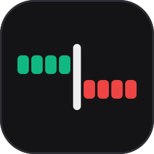
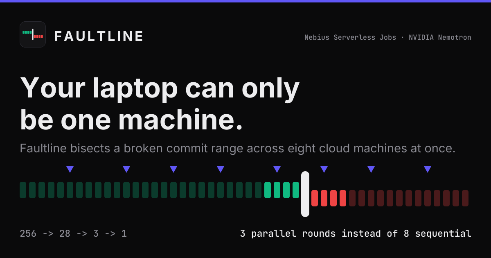

<div align="center">



# Faultline

**Your laptop can only be one machine.**
Faultline bisects a broken commit range across eight cloud machines at once — and tells you why it broke.



[](https://docs.nebius.com/serverless)
[](https://huggingface.co/nvidia/OpenCodeReasoning-Nemotron-14B)
[](https://nextjs.org)
[](#-tests)
[](LICENSE)

</div>

---

## 🩸 The problem

`git bisect` is twenty years old and still the right algorithm. What changed is that a modern
repository's test suite is **environment-sensitive**: dependency versions drift across a commit
range, so testing commit N needs a build that commit N+50 would break. That makes unattended
`git bisect run` unsafe — a false "pass" from a stale environment sends the search down the
wrong half and silently blames an innocent commit.

So maintainers bisect by hand. And because a laptop is one machine, they bisect **sequentially**:
log₂(256) ≈ 8 rounds, each a full rebuild.

The bottleneck is not the algorithm. It is that **one developer has one machine**, and each
probe needs a clean, differently-configured one.

## ⚡ What Faultline does

Give it three things — a repository, a failing test command, a known-good ref — and it dispatches
a **band** of candidate commits as independent Nebius Serverless AI Jobs. Each job is an isolated,
terminating container that checks out one commit, installs **that commit's own declared
dependencies from scratch**, runs the test, and reports a verdict. The band's result pattern
narrows the suspect range; the next band goes out.

The output is not a commit hash. It is a **Fault Report**: the guilty commit, its diff, a
plain-English explanation from an NVIDIA model, and a copy-as-GitHub-issue button.

## 🧮 Why N-ary, not binary

Binary bisection is optimal **when probes are sequential**, because each result informs the next
choice. Faultline's probes are simultaneous, which changes the problem: with N probes per round
the range is cut into **N+1 segments**, so it divides by **N+1**.

With N = 8 the divisor is 9:

| Range | Sequential binary | Faultline (N=8) | Chain |
|---|---|---|---|
| 64 commits | 6 rounds | **2 rounds** | 64 → ~8 → 1 |
| 128 commits | 7 rounds | **3 rounds** | 128 → ~15 → ~2 → 1 |
| 256 commits | 8 rounds | **3 rounds** | 256 → ~29 → ~3 → 1 |
| 1000 commits | 10 rounds | **4 rounds** | 1000 → ~112 → ~13 → ~2 → 1 |

These are not estimates from a formula. `tests/planner.test.ts` simulates the real planner
against **every possible culprit position** for each range size and takes the worst case — and
`estimateRounds()`, which drives the "Round 2 of ~3" line in the UI, simulates rather than
computing a logarithm, so the number on screen cannot drift from the search actually performed.

> `256 ÷ 8 = 32` is the divisor for a different algorithm. The correct round-1 figure is **~29**,
> and the test suite fails if it is ever 32.

We trade total compute (up to 24 job-runs instead of 8) for wall-clock (3 rounds instead of 8).
That trade is only rational because Serverless AI Jobs bill **per second** and run in parallel.

## 🔌 Where Nebius does the work

The genuinely hard part of bisection-at-scale is **manufacturing N isolated, correctly-versioned
build environments simultaneously**. Faultline does not implement that. Nebius does.

| Surface | Where in the code | What it does |
|---|---|---|
| Serverless AI Jobs (CPU) | `src/lib/nebius/jobs.ts` | every probe — 8 concurrent, terminating, `cpu-e2`/`2vcpu-8gb` |
| Serverless AI Jobs (GPU) | `src/lib/narrate.ts` | the NVIDIA model, one terminating job per hunt, `gpu-l40s-a`/`1gpu-8vcpu-32gb` |
| Job polling and cancel | `getJob`, `cancelJob` | the reconcile tick; outstanding probes are cancelled the moment the answer is known, because jobs bill per second |
| Object Storage, mounted | `spec.volumes[].s3Config` | **the verdict channel** — see below |
| Object Storage, S3 API | `src/lib/nebius/storage.ts` | hunt state, probe verdicts, narration output |
| IAM token exchange | `src/lib/nebius/auth.ts` | RS256 JWT signed with the service-account key, exchanged for a Bearer token |

**Remove Serverless AI Jobs and Faultline degrades into a `git bisect` wrapper that already
exists.**

Deliberately **not** used: Serverless **Endpoints** (a `RUNNING` endpoint bills continuously and
needs a human to stop and start it across a judging window; narration is one latency-insensitive
call, so a job that exits is the correct shape), **Token Factory** (card-walled on this account —
documented in [`FEEDBACK.md`](FEEDBACK.md), not faked), and **Sandboxes**.

`GET /api/integrations/verify` renders the job IDs and API calls already on record, so this table
is checkable in thirty seconds without reading code.

## 🧠 The NVIDIA model

`nvidia/OpenCodeReasoning-Nemotron-14B` (Apache-2.0, 32K context), run as a terminating GPU job.

Chosen because the task is *reading a diff plus a traceback and explaining causation* — code
reasoning, not code generation. A general instruct model summarises the diff ("this changes the
timezone handling"); a code-reasoning model connects the change to the observed failure.

**The model explains; it never decides.** The guilty commit is produced by test execution across
the commit range, so a wrong or missing completion degrades the report's prose without touching
the claim the product defends. The UI labels the generated paragraph so it is never mistaken for
the verified part.

## 🕵️ The design detail we are proudest of

**The Jobs API cannot report a test result.** There is no exit-code field anywhere in the
`Job`/`JobStatus` schemas, and job logs are not available over REST — the Nebius docs state that
verbatim, twice. So `status.state` tells you the container *ran*; it cannot tell you the test
*passed*, because a test runner exits non-zero on purpose.

So the probe reports for itself: it writes a JSON verdict into the Object Storage bucket mounted
into its own container, and the object's existence is the completion signal. Three consequences
the code makes explicit:

- **A terminal job with no verdict object is an `error`, never a `fail`.** Recording it as a
  failure would narrow the range onto a commit whose test never ran, and blame an innocent author.
- The verdict is written **atomically**, so a partially-flushed file is never read.
- A transient polling failure leaves the probe pending rather than deciding a verdict.

## 🛑 Honest refusal

If the verdict sequence is non-monotonic — a `pass` at a **higher** commit index than a `fail` —
then no single first-bad commit explains the results, and Faultline names none. It shows the
contradicting pair and the evidence instead.

This is a pure function over verdicts already collected, so the honest answer costs **zero extra
jobs**. No commit is ever re-probed.

What is *not* a refusal: a round where every probe fails, or every probe passes. Both are
explicable — the culprit is early, or late — and both narrow correctly onto a real commit. An
earlier version refused there, which made the tool decline to answer in exactly the two positions
a bisection must handle; the end-to-end test caught it. They earn a caveat on the report instead.

## 🧪 Tests

**104 passing.** `npm test`

| Suite | What it pins down |
|---|---|
| `tests/planner.test.ts` (36) | The N+1 divisor, directly. Round counts are the worst case over **every** culprit position, not an average. A 400-trial seeded fuzz always finds the planted culprit. |
| `tests/verdicts.test.ts` (39) | Every refusal branch, contradiction outranking everything, and the edge-culprit regression. |
| `tests/sigv4.test.ts` (13) | The S3 signer against **AWS's own published signature vectors** — the only way to trust a signature implementation without live credentials. |
| `tests/hunt.integration.test.ts` (8) | A full hunt through the real dispatch and reconcile code, with Nebius simulated at the HTTP boundary. Asserts "3 rounds, ≤24 job-runs, correct culprit" against the system as shipped. |
| `tests/issue.test.ts` (8) | The pasteable GitHub issue: evidence trail, model attribution, and no invented prose when narration fails. |

## 🚀 Running it

```bash
npm install
npm test          # 104 tests, no credentials needed
npm run dev
```

The app runs with **no environment variables at all** — the landing page and the recorded example
render without credentials, which is what a cold visit must survive. Credentials are needed only
to dispatch live hunts; see [`.env.example`](.env.example) and `scripts/provision.sh`.

## ⚠️ What is not true yet

Stated plainly, because a README that hides this is worth less than one that does not.

- **No hunt has ever run against live Nebius infrastructure.** The account's tenant has been
  `SUSPENDED` since 21 seconds after its creation, so `job create` returns `PermissionDenied`.
  Every Nebius call path is implemented and tested against a simulated API at the HTTP boundary;
  none has been exercised against the real one. Details and timestamps in
  [`FEEDBACK.md`](FEEDBACK.md) §1.
- **There are therefore no measured wall-clock or cost figures anywhere in this repository**, and
  no recorded example hunt. `GET /api/examples/recorded` returns `available: false` with a reason
  rather than synthesising a run. Every number above is a property of the algorithm, proven by
  the test suite; none is a performance claim.
- Python test suites only. Public GitHub repositories only.
- Mobile is legible, not optimised: one breakpoint stacks the timeline with identical colour
  semantics. There is no dedicated mobile design pass.

## 📐 More

- [`ARCHITECTURE.md`](ARCHITECTURE.md) — written from the code, every claim naming its file
- [`FEEDBACK.md`](FEEDBACK.md) — feedback for Nebius, including five documentation and API gaps
- [`probe/README.md`](probe/README.md) — the probe container's env-var and verdict contracts
- [`DEMO.md`](DEMO.md) — every command, with the output it actually printed
- [`narration/README.md`](narration/README.md) — why narration is a job and not an endpoint

## 📄 License

MIT — see [LICENSE](LICENSE).
